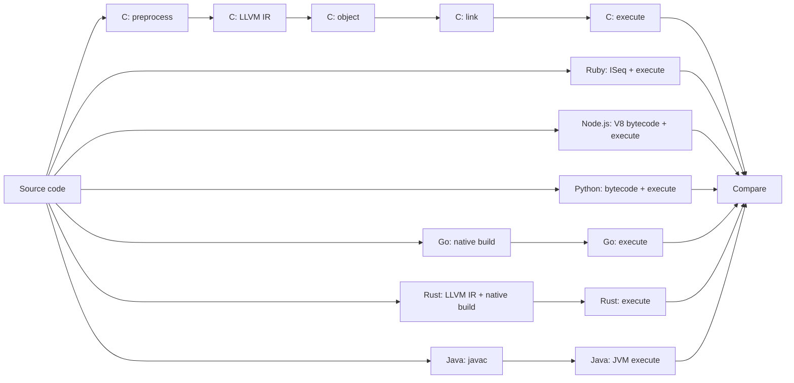

# programming-parts

C、Ruby、Node.js、Javaのソースコードが、実行されるまでにどのような表現を通るのかをGitHub Actionsのジョブグラフで比較する教材です。

## 可視化する経路



GitHub Actionsでは `.github/workflows/language-pipelines.yml` の `needs` がこの依存関係を表します。実行後は次の2箇所で確認できます。

- Actionsのジョブグラフ: 実行経路と段階の境界
- Workflow Summary: コマンド、中間成果物、SHA-256、実行結果

## 比較対象

| 系統             | ソース                     | 観測する表現                                           | 最終的な実行器  |
| ---------------- | -------------------------- | ------------------------------------------------------ | --------------- |
| C / Clang        | `examples/c/hello.c`       | プリプロセス済みC、LLVM IR、オブジェクト、実行ファイル | CPU             |
| CRuby            | `examples/ruby/hello.rb`   | YARV命令列（ISeq）                                     | YARV、任意のJIT |
| Node.js / V8     | `examples/node/hello.js`   | V8バイトコード                                         | Ignition、JIT群 |
| Java / OpenJDK   | `examples/java/Hello.java` | JVMバイトコード（`.class`）                            | JVM、任意のJIT  |
| Python / CPython | `examples/python/hello.py` | CPythonバイトコード（`.pyc`）                          | CPython VM      |
| Go               | `examples/go/hello.go`     | アセンブリ、ネイティブ実行ファイル                     | CPU             |
| Rust             | `examples/rust/hello.rs`   | LLVM IR、オブジェクト、ネイティブ実行ファイル          | CPU             |

Ruby、Node.js、Pythonの中間表現は、通常の実行ではランタイム内部に保持されます。そのため、Actions上で中間成果物を次ジョブへ渡すC、Go、Rust、Javaとは分け、同一ジョブ内で観測と実行を行います。Rubyは生成したISeq自体をそのプロセスで評価します。Node.jsはbytecode表示にもスクリプト実行が伴いますが、通常出力と観測ログを分離するため、出力確認だけを別プロセスでもう一度実行します。

## 実行方法

次のいずれかでWorkflowを起動します。

- `main`へのpush
- Pull Request
- Actions画面の `Run workflow`

ローカルでは集約スクリプトのテストだけを実行できます。

```sh
nr test
```

Actionsのジョブは別々の仮想マシンで動くため、ジョブ所要時間を言語性能の比較には使用しません。このプロジェクトが比較するのは処理時間ではなく、表現の変化と実行責務の境界です。
